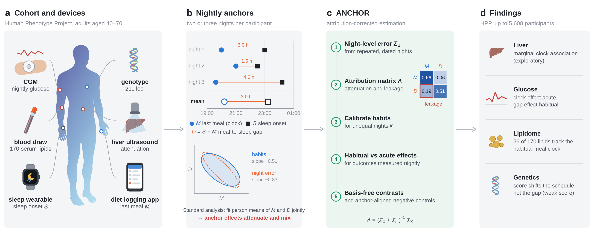
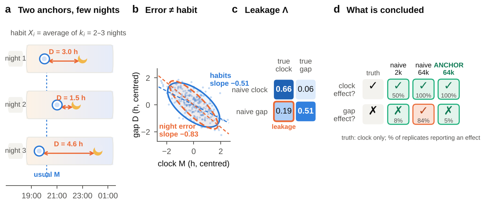
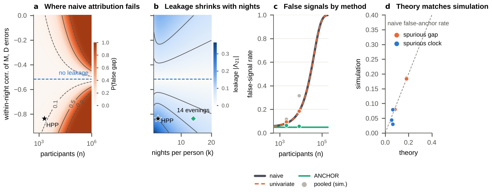
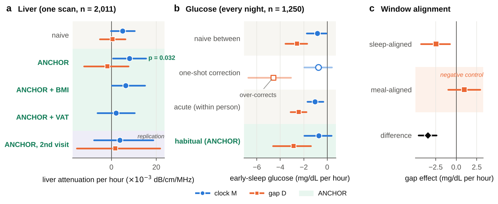
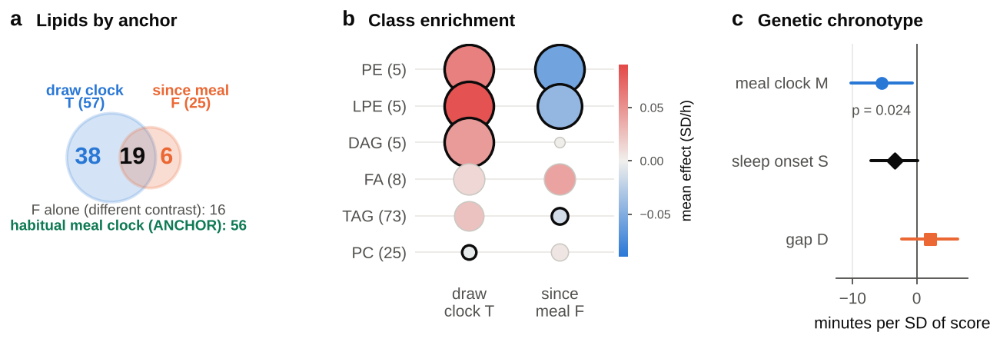
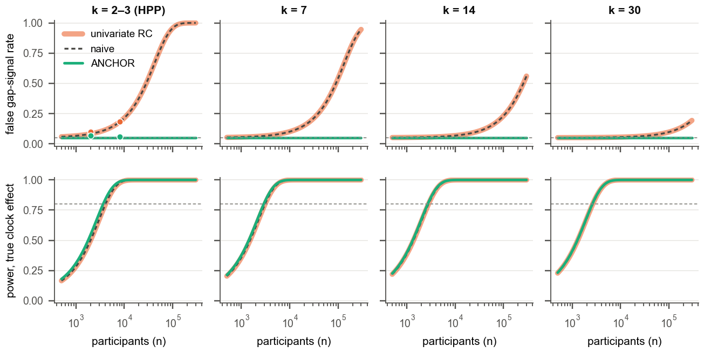

<h1 align="center">
<strong>Spurious Time-Anchor Attribution in Wearable and Molecular Biobanks: Detection and Correction with ANCHOR</strong>
</h1>

<div align="center">

<a href="https://git.io/typing-svg">

</a>

[](#-citation)
[](#-data-access)
[](#️-installation)
[](pyproject.toml)
[](LICENSE)
[](https://visitorbadge.io/status?path=https%3A%2F%2Fgithub.com%2Fadinathdukre%2Fanchor)

<h3>🧠 <a href="#-method">Method</a> &nbsp;|&nbsp; 🏆 <a href="#-results">Results</a> &nbsp;|&nbsp; ⚡ <a href="#-quick-start">Quick start</a> &nbsp;|&nbsp; 🔁 <a href="#-reproducing-the-paper">Reproduce</a></h3>

**[Adinath Madhavrao Dukre](https://github.com/adinathdukre), Imran Razzak**

Mohamed bin Zayed University of Artificial Intelligence, Abu Dhabi, UAE


</div>

## 🔥 News
- **[Nov 2026]** 🚀 Code for ANCHOR, the simulations, the public NHANES analysis, the scripts run inside the HPP environment and all aggregate results are released.
- 📄 The paper is submitted to **RECOMB 2027**.

## Overview
Official code for **ANCHOR**, an add-on to the standard analysis of timing exposures in biobanks.

Wearable biobanks summarise a few nights of behaviour as exposures measured from different time anchors, for example the clock time of the last meal *M* and its interval to sleep onset *D = S − M*, and fit both jointly to decide which anchor matters. Averaging a few noisy nights gives an estimator that converges to **Λβ**, where the *attribution matrix* Λ = (Σ<sub>X</sub> + Σ<sub>U</sub> E[1/k])<sup>−1</sup> Σ<sub>X</sub> both attenuates and mixes anchor effects. Because both exposures are built from the same events, night-to-night error and habits have differently shaped covariances, so signal leaks from one anchor to the other, and the false anchor signal becomes more likely, not less, as cohorts grow.

<p align="center">

<em><b>Fig. 1.</b> Overview. (a) HPP participants contribute CGM, a blood draw for serum lipidomics and a sleep wearable, together with genotypes, liver ultrasound and a diet-logging app. (b) Habits are averages of 2–3 noisy nights; the gap D = S − M is defined from the same events as M, so night-to-night error has a steeper slope than habits. (c) ANCHOR estimates the night-level error from repeated nights, quantifies the mixing with Λ, calibrates habits, separates habitual from acute effects and reports basis-free contrasts with negative controls. (d) Main findings.</em>
</p>

## 📖 Contents
- [🧠 Method](#-method)
- [🏆 Results](#-results)
- [⛏️ Installation](#️-installation)
- [⚡ Quick start](#-quick-start)
- [🔁 Reproducing the paper](#-reproducing-the-paper)
- [🔒 Data access](#-data-access)
- [🗂️ Repository Structure](#️-repository-structure)
- [⚠️ Limitations](#️-limitations)
- [📝 Citation](#-citation)
- [📚 Acknowledgments](#-acknowledgments)
- [📨 Contact](#-contact)
- [📜 License](#-license)

## 🧠 Method

<p align="center">

<em><b>Fig. 2.</b> Problem setup. In HPP the 95% ellipse of night-to-night error in a person mean has a different slope from the habit ellipse. The resulting attribution matrix recovers 66% of a true clock effect and 51% of a true gap effect, and reports 19% of a true clock effect as a gap effect.</em>
</p>

- **Outcome-free leakage check.** Leakage from one anchor to the other vanishes only when the within-person and between-person slopes of one anchor on the other coincide. Both slopes come from the nightly table alone, before any outcome model is fitted (`leak_check`).
- **Calibration with unequal nights.** Each person mean is replaced by the best linear prediction of the habit, shrinking both anchors jointly and people with fewer nights more. A reliability floor caps noise amplification when habits are nearly collinear.
- **Dated nights.** If nightly errors are correlated, the within-person semivariogram of dated nights identifies the night-to-night correlation, and each person's night count is replaced by an effective number of nights.
- **Habitual versus acute effects.** For outcomes measured every night (e.g. CGM), the person-mean slope mixes habitual and acute effects, so the standard one-shot correction over-corrects. ANCHOR solves the mixture for the habitual effect and tests whether the two differ.
- **Basis-free contrasts and negative controls.** Interventional contrasts (later meal at the same bedtime, whole schedule shifted, later bedtime at the same meal) do not depend on the chosen anchors, and anchor-aligned outcome windows act as negative controls.
- **Inference and scale.** A participant bootstrap resamples whole people with all their nights. Calibration does not depend on the outcome, so all outcomes are solved together.

## 🏆 Results

As reported in the paper:

- At the HPP error structure, the naive joint model reports a true clock effect as a gap effect in 8% of studies at HPP size (n = 2,011). If the same error structure and effect size held, this would rise to 84% at n = 64,000.
- In spike-ins on HPP's own nightly data, the naive false-gap rate reached 56% at n = 32,176, while ANCHOR stayed near the nominal level (about 4–7%) in simulations that satisfy its assumptions and in the spike-ins.
- With autocorrelated nights, the i.i.d. version of ANCHOR reached 10–11% false signals; the dated-night extension restored 6%.
- In HPP, the standard one-shot correction overstated the habitual gap effect on early-sleep glucose by 60% (n = 1,250). A meal-aligned negative-control window was consistent with the gap acting through time since eating.
- In the serum lipidome (n = 5,608), habitual meal timing was associated with 56 of 170 lipids (14 in a joint model with blood-draw clock and fasting time, n = 2,458), and the implicit anchor choice changed which lipids appeared fasting-sensitive.
- All analyses in HPP are exploratory; the liver association is marginal and not replicated at the second visit.

<p align="center">

<em><b>Fig. 3.</b> Where and why naive attribution fails. (a) Probability that a naive joint model reports a gap effect when only the clock matters, over cohort size and the within-night error correlation. (b) Leakage falls with nights per person. (c) False gap-signal rate by estimator: theory (lines) and simulation (points). (d) Theory agrees with simulation across all settings.</em>
</p>

<p align="center">

<em><b>Fig. 4.</b> Phenotype results. (a) Liver attenuation per hour later. (b) Early-sleep glucose: naive between-person estimates, the standard one-shot correction, acute within-person effects and ANCHOR habitual effects. (c) Habitual gap effect in sleep-aligned and meal-aligned glucose windows on identical nights; the meal-aligned window is a negative control. Bars: 95% intervals.</em>
</p>

<p align="center">

<em><b>Fig. 5.</b> Molecular and genetic readouts. (a) Serum lipids associated with draw clock and time since the last meal in a joint model, and with ANCHOR-calibrated habitual meal clock. (b) Lipid-class enrichment. (c) Association of a 211-variant morningness score with meal clock, sleep onset and gap; the gap estimate is a null result from a weak score.</em>
</p>

<details>
<summary><b>Supplementary figure</b> (click to expand)</summary>

<p align="center">

<br/><em><b>Figure S1.</b> False gap-signal rate and power for a true clock effect against cohort size, by nights per person, at HPP calibration.</em>
</p>

</details>

## ⛏️ Installation

```bash
git clone https://github.com/adinathdukre/anchor.git
cd anchor
pip install -e .
```

or directly:

```bash
pip install git+https://github.com/adinathdukre/anchor
```

The `anchor` package needs Python ≥ 3.9 and NumPy only. The simulations and figures additionally use pandas, SciPy and Matplotlib:

```bash
pip install numpy pandas matplotlib scipy
```

On macOS with NumPy 2.0 you may see `RuntimeWarning`s from `matmul`. They did not change the results in our checks.

## ⚡ Quick start

A runnable example on simulated data, with a true clock effect and no gap effect:

```bash
python examples/quickstart.py
```

The main calls:

```python
import anchor

# pid: participant id per night; W: nightly anchors (n_nights x 2), e.g. [meal clock M, gap D]
anchor.leak_check(pid, W)                              # do my anchors leak? (no outcome needed)

ids, Wbar, k, Su, _ = anchor.person_summaries(pid, W)
beta = anchor.fit_anchor(Wbar, k, Su, y, C)            # one outcome
B = anchor.fit_anchor_many(Wbar, k, Su, Y, C)          # many outcomes (columns of Y) at once
draws = anchor.bootstrap_many(pid, W, Y, C, B=200)     # participant bootstrap, all outcomes
beta_d, phi = anchor.fit_anchor_dated(pid, W, t, y, C) # dated nights (t in days)
```

> [!TIP]
> Run `leak_check` on any study with repeated nights before fitting two anchors jointly. If the within- and between-person slopes differ, report corrected effects and interventional contrasts rather than which coefficient survives, and record night dates.

**Scale.** On a single Python process (Apple M4 Pro laptop, NumPy 2.0 with Apple Accelerate BLAS; `code/sim/bench_scale.py`), ANCHOR fitted 10,000 outcomes for 5,608 participants (78,000 nights) in 0.27 s (200-draw bootstrap: 61 s), and 1,000 outcomes for 100,000 participants (1.4 million nights) in 0.5 s.

## 🔁 Reproducing the paper

```bash
python code/sim/sim_real.py            # analytic false-signal curve (seconds)
python code/sim/sim_real.py 300 150    # HPP-calibrated Monte Carlo (~30 min)
python code/sim/sim_nightly.py         # habitual vs acute simulation
python figures/make_figures.py         # regenerate Figs. 2, 4, 5 from results/
python figures/make_fig2_regimes.py    # Fig. 3
python figures/make_fig_grid.py        # Fig. S1
```

The simulation outputs and the transcribed aggregate HPP estimates are in `results/`, so every figure can be regenerated without HPP access.

The NHANES replication uses public data and needs no special access:

```bash
sh code/nhanes/download.sh          # about 5.5 MB from the CDC, saved to data_external/
python code/nhanes/nhanes_anchor.py # writes results/nhanes_anchor*.csv
```

`figures/make_overview.py` draws the overview figure and needs Playwright with headless Chromium.

## 🔒 Data access

No participant-level data are included in this repository.

- **Human Phenotype Project (HPP).** Data are available to bona fide researchers through the project's data-access application ([humanphenotypeproject.org/data-access](https://humanphenotypeproject.org/data-access)). Access is provided through a secure cloud-based environment after signing a data-access agreement for non-commercial use.
- **HPP scripts.** The scripts in `code/hpp/` were run inside the HPP trusted research environment, and only aggregate estimates left it. They need approved HPP access and run only inside its environment; see [`code/hpp/README.md`](code/hpp/README.md).
- **Genotypes.** Individual-level genetic data are available from the European Genome-phenome Archive under accession EGAS00001008040. `code/hpp/bgzf_extract.py` is an index-free random-access reader for the per-participant low-pass VCFs.
- **NHANES.** The public NHANES 2017–2018 replication uses openly available data (`code/nhanes`).

## 🗂️ Repository Structure

```text
anchor/
├── code/
│   ├── anchor/           # ANCHOR library: attribution matrix, calibration with reliability floor,
│   │                     # habitual/acute decomposition, dated nights, participant bootstrap, leak_check
│   ├── sim/              # simulations (HPP-calibrated: sim_real.py; repeated outcomes: sim_nightly.py;
│   │                     # baselines, stress tests, dated nights, latent-covariate model, benchmark)
│   ├── hpp/              # scripts run inside the HPP TRE (aggregate output only); data/ = chronotype loci
│   └── nhanes/           # NHANES 2017–2018 anchor-basis replication
├── examples/             # quickstart.py on simulated data
├── figures/              # figure scripts; figure PDFs and PNG previews; icons/ (CC0)
├── results/              # simulation outputs, transcribed aggregate HPP estimates, NHANES outputs
└── pyproject.toml        # package `anchor-attribution`
```

## ⚠️ Limitations

- Calibration assumes additive nightly error independent of habits; in HPP the number of logged nights depended weakly on habits.
- Dietary covariates were not calibrated.
- Habits span about two weeks of logging, whereas some outcomes (e.g. liver fat) reflect months.
- Habitual effects are causal only under exchangeability of habits given covariates; acute effects assume no time-varying confounding.
- All HPP analyses are exploratory and cross-sectional, and external replication is needed.

## 📝 Citation

If you find our paper and code useful in your research, please cite:

```bibtex
@misc{dukre2026anchor,
  title  = {Spurious time-anchor attribution in wearable and molecular biobanks: detection and correction with {ANCHOR}},
  author = {Dukre, Adinath Madhavrao and Razzak, Imran},
  note   = {Submitted to RECOMB 2027},
  year   = {2026},
  url    = {https://github.com/adinathdukre/anchor}
}
```

## 📚 Acknowledgments

We gratefully acknowledge the participants and study staff of the Human Phenotype Project for their contribution to this work, and thank Tal Shor and other members of Pheno.AI for their support. Overview artwork uses icons from [bioicons.com](https://bioicons.com) (CC0).

## 📨 Contact
For questions or collaboration, please open an [issue](https://github.com/adinathdukre/anchor/issues) or reach out to [Adinath Madhavrao Dukre](https://github.com/adinathdukre).

## 📜 License

This project is licensed under the MIT License. See the [LICENSE](LICENSE) file for details.

> [!IMPORTANT]
> ANCHOR is intended for research only. Its estimates are not clinical guidance and must not inform any diagnostic or treatment decision.
